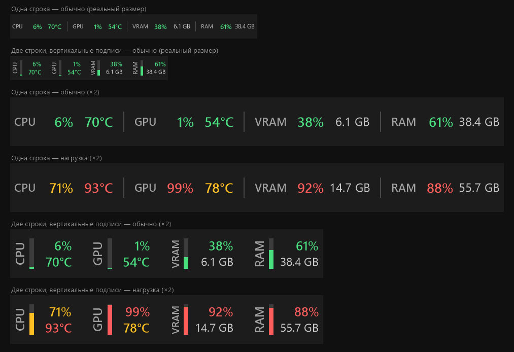

# PulseBar

Строка состояния на панели задач Windows 11: загрузка и температура CPU, загрузка и температура GPU,
занятая видеопамять (VRAM) и оперативная память (RAM), лимиты подписки Claude (5 часов и 7 дней), заряд клавиатуры
и мыши Logitech. Значения подсвечиваются
по порогам: норма — зелёный (или синий), повышенная — жёлтый, перегруз — красный.



## Установка

Скачайте `PulseBar-Setup-<версия>.exe` со страницы [Releases](https://github.com/CajuTheOne/PulseBar/releases)
и запустите. Установщик:

- ставит программу в `C:\Program Files\PulseBar` и службу **PulseBarSensor** (температура CPU);
- при необходимости скачивает .NET 9 Desktop Runtime и драйвер [PawnIO](https://pawnio.eu) (галочка);
- включает автозапуск при входе в Windows (`HKCU\...\Run`, без прав администратора);
- удаляет PulseBar 1.x (задачу Планировщика `\AI Tools\PulseBar` и папку `C:\Program Files\AI Tools\PulseBar`),
  настройки сохраняются.

Установщик не подписан: при первом запуске Windows SmartScreen покажет «Неизвестный издатель» → «Подробнее» →
«Выполнить в любом случае». Удаление — «Параметры → Приложения».

**Обновления** PulseBar проверяет сам — при запуске и раз в сутки. Когда выйдет новая версия, в углу строки
появится голубая точка, а в меню — пункт «Обновить до x.y» (один запрос UAC, программа перезапустится).
Бета-версии — пункт меню «Получать бета-версии».

## Коротко

- **Правый клик** по строке — короткое меню: «Обновить до x.y» (если есть), **Настройки…**, профиль Logitech,
  Диспетчер задач, выход.
- **Настройки** — окно с вкладками (тема Windows 11): Вид (превью строки, готовые варианты «Стандарт», «Компакт»,
  «Минимум», «Игровой» и «Дополнительно»), Блоки (порядок перетаскиванием, вкл/выкл), Пороги, Клавиатура и Мышь
  (настройки Windows), Claude, О программе (обновления, бета-версии).
- **Наведение** на блок — подсказка с подробностями и графиком за 60 секунд; у Claude — время до сброса.
- **Двойной клик** — Диспетчер задач.
- Строка — дочернее окно панели задач: не моргает, прячется вместе с панелью. Если встроиться не удалось
  (или пункт «Встраивать в панель задач» выключен) — окно поверх панели, как в 1.x.
- Языки: English (по умолчанию), Русский, Українська, Deutsch, Français, Español, Português, Italiano, Polski, 中文, 日本語.

## Откуда данные

| Показатель | Источник | Права |
|---|---|---|
| Загрузка CPU | счётчик `Processor Information\% Processor Utility` (как в Диспетчере задач) | не нужны |
| Температура CPU | служба PulseBarSensor через драйвер PawnIO: AMD Ryzen — Tctl/Tdie (модуль `AMDFamily17`), Intel — температура пакета (`IntelMSR`) | у службы |
| Загрузка / температура GPU | D3DKMT — тот же источник, что у Диспетчера задач; спящую дискретную видеокарту не будит | не нужны |
| Занятая VRAM | D3DKMT: сумма сегментов собственной памяти видеокарты («Выделенная память» в Диспетчере задач) | не нужны |
| Загрузка RAM | `GlobalMemoryStatusEx` | не нужны |
| Лимиты Claude | история приложения Claude (`%APPDATA%\Claude\plan-usage-history.json`, раз в ~15 мин) и claude.ai (`api/oauth/usage` по входу Claude Code, редко: сервер отклоняет частые запросы) | не нужны |

## Лёгкость

- Строка: ~23 МБ собственной памяти, 0,16–0,4 % одного ядра при обновлении раз в секунду (≈0,01 % всего CPU).
  Служба отвечает только на запросы строки (~8 МБ).
- Окно настроек — отдельный процесс (`PulseBar.exe --settings`, WPF, ~120 МБ): память освобождается, когда окно
  закрыто; строка WPF не загружает.
- Никаких сторонних библиотек: только .NET 9 и вызовы Windows API. Код предкомпилирован (ReadyToRun).
- Перерисовка только при изменении значений; таймер с допуском (Windows объединяет пробуждения), режим EcoQoS.
- У видеокарты опрашиваются только 3D/вычисления (каждый раз) и видеокодеки (реже, пока простаивают).
- Пока строка скрыта (полноэкранная игра/видео), датчики не опрашиваются.

## Сборка

```powershell
powershell -ExecutionPolicy Bypass -File build.ps1 -Version 2.0.0-beta.1   # artifacts\publish + artifacts\installer\PulseBar-Setup-*.exe
powershell -ExecutionPolicy Bypass -File build.ps1 -NoInstaller           # только программа
```

Нужны .NET SDK 9 и Inno Setup 6 (`winget install JRSoftware.InnoSetup`). Промежуточные файлы сборки — в
`%LOCALAPPDATA%\PulseBar-build` (исходники могут лежать на сетевом диске).
Релиз: тег `v2.0.0` (стабильный) или `v2.0.0-beta.1` (бета) → GitHub Actions собирает установщик и публикует релиз.

Настройки: `%APPDATA%\PulseBar\settings.json` (с 2.1; `settings.ini` переносится сам; модуль Logitech — `logitech.json`),
журналы: `%LOCALAPPDATA%\PulseBar\pulsebar.log` (строка), `%ProgramData%\PulseBar\sensor.log` (служба).
Диагностика: `PulseBar.exe --dump` пишет одно измерение в `%TEMP%\PulseBar-dump.txt`;
`PulseBar.Sensor.exe --dump` (от администратора) — температура CPU напрямую.

Требуется: Windows 10/11 x64, .NET 9 Desktop Runtime, для температуры CPU — AMD Ryzen или Intel Core и PawnIO.

## Документация

| Файл | О чём |
|---|---|
| [docs/PLAN-2.x.md](docs/PLAN-2.x.md) | План версий 2.0–2.3 |
| [docs/ARCHITECTURE.md](docs/ARCHITECTURE.md) | Как устроено: окно, z-порядок, датчики, отрисовка, производительность, ограничения |
| [docs/SETTINGS.md](docs/SETTINGS.md) | Меню, окно настроек, `settings.json`, команды |
| [docs/HISTORY.md](docs/HISTORY.md) | История разработки, принятые решения, исправленные ошибки |
| [docs/COMPARISON.md](docs/COMPARISON.md) | Сравнение с Claude Code Usage Monitor: встраивание в панель задач и иконка в трее |

Лицензия — [MIT](LICENSE); сторонние компоненты — [THIRD-PARTY-NOTICES.md](THIRD-PARTY-NOTICES.md).

## Папка на NAS

Рабочая копия репозитория — `N:\AI\Tools\PulseBar`. Только на NAS (не в git):

| Папка | Что |
|---|---|
| `publish\` | текущая сборка (файлы программы) |
| `releases\<версия>\` | установщики и прежние сборки (`1.0.0`, `1.1.0`, `2.0.0-beta.1`) |
| `config\<ПК>[-<пользователь>]\` | `settings.json`, `logitech.json` и журналы с каждого ПК |
